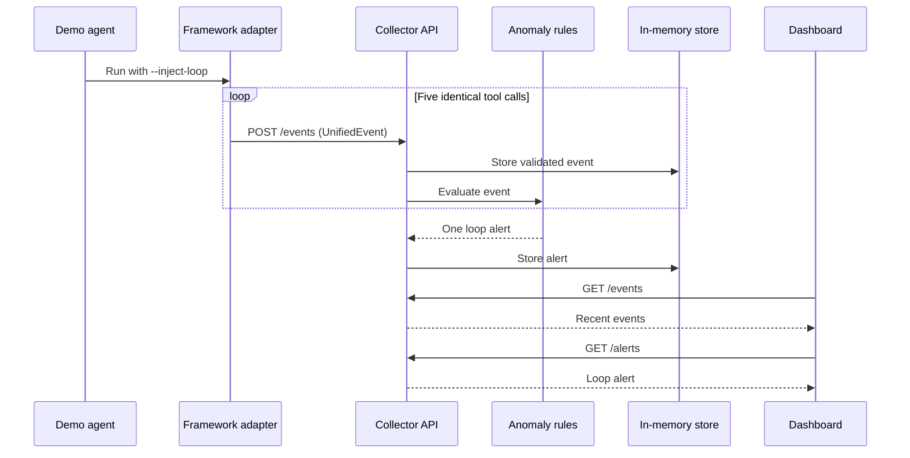

# AgentGuard Core Architecture

AgentGuard Core is a small, framework-neutral observability toolkit for AI-agent applications. It converts LangChain, AutoGen, and CrewAI activity into one validated event contract, evaluates lightweight anomaly rules, and exposes recent events and alerts to a single-page dashboard.

The submission architecture prioritizes a deterministic local demo over production-scale governance.

## System Context

```mermaid
flowchart LR
    subgraph Workloads[Agent workloads]
        LC[LangChain]
        AG[AutoGen]
        CR[CrewAI]
    end

    subgraph SDK[Telemetry SDK]
        LA[LangChain adapter]
        AA[AutoGen adapter]
        CA[CrewAI adapter]
        UE[UnifiedEvent validation]
        PUB[In-memory or Redis publisher]
    end

    subgraph Core[AgentGuard collector]
        API[FastAPI collector]
        STORE[In-memory state store]
        RULES[Loop, token-spike, and cost rules]
    end

    UI[One-page dashboard]

    LC --> LA
    AG --> AA
    CR --> CA
    LA --> UE
    AA --> UE
    CA --> UE
    UE --> PUB
    PUB -->|POST /events| API
    PUB -. optional agent.events stream .-> API
    API --> STORE
    API --> RULES
    RULES --> STORE
    UI -->|GET /health, /events, /alerts| API
```

## Authoritative Message Contract

`UnifiedEvent` is the only event format shared between components. Framework adapters perform framework-specific translation before publishing. The backend validates canonical JSON directly; `LogNormalizer` only decodes and validates Redis fields and does not define a second schema.

```json
{
  "event_id": "uuid",
  "agent_id": "string",
  "framework": "langchain | autogen | crewai",
  "parent_agent_id": "string | null",
  "task_id": "string",
  "team_id": "string",
  "status": "running | success | failed | paused | quarantined",
  "event_type": "start | tool_call | llm_call | finish | error",
  "tokens_in": 0,
  "tokens_out": 0,
  "cost_usd": 0.0,
  "timestamp": "UTC ISO-8601",
  "trace_id": "string",
  "payload": {}
}
```

Unknown fields, unsupported enum values, negative usage values, blank required identifiers, and timestamps without timezone information are rejected.

## Components

### Framework adapters

The adapters observe framework callbacks and emit canonical events without changing agent behavior. Publishing failures are logged and remain non-blocking so telemetry cannot crash the instrumented workload.

- LangChain callbacks cover chains, language-model calls, and tools.
- AutoGen middleware wraps reply generation.
- CrewAI hooks cover crews, tasks, agent actions, and failures.
- Shared context supplies task, team, agent, parent, and trace identity.

### Publisher boundary

The publisher interface separates instrumentation from transport:

- `CollectingEventPublisher` provides deterministic in-memory tests and demos.
- `RedisEventPublisher` appends a JSON `payload` field to `agent.events`.
- Direct HTTP ingestion uses the same serialized `UnifiedEvent` body.

Redis is optional for the minimal demo. The HTTP path is the shortest supported end-to-end route.

### Collector API

The FastAPI collector validates events and owns the process-local state store.

| Endpoint | Purpose |
| --- | --- |
| `GET /health` | Process liveness |
| `POST /events` | Validate and store one canonical event |
| `GET /events` | Return up to 500 recent events |
| `GET /alerts` | Return up to 100 recent alerts |

When Redis is enabled, the event bus consumes `agent.events`, decodes the `payload` field, validates it with the same event model, and stores it through the same collector boundary. Invalid stream records are moved to `agent.events.invalid` before acknowledgement.

State is intentionally in memory for the submission. Restarting the collector clears events and alerts.

### Anomaly rules

Rules consume validated events and return structured alerts. The reduced rule set is:

- Loop detection after five consecutive identical tool calls within a trace.
- Token-spike detection against a rolling 20-call baseline.
- One cost alert when accumulated task cost exceeds its configured budget.

Rule evaluation must not mutate or reject the source event. Each anomaly episode produces at most one visible alert until its rule state resets.

### Dashboard

The dashboard is a read-only operational view. It polls every two seconds and shows:

- collector health;
- recent events with agent, framework, type, status, tokens, and cost;
- recent alerts with severity and reason;
- explicit loading, empty, and error states.

The dashboard does not issue commands or control agents in the MVP.

## End-to-End Demo Flow



The acceptance path is complete when `--inject-loop` produces five canonical tool-call events and exactly one alert visible on the dashboard.

## Failure Handling

- Invalid HTTP events receive HTTP `422` and are not stored.
- Duplicate event IDs are idempotent and do not create duplicate state.
- Redis outages degrade the optional stream path without preventing the HTTP collector from running.
- Adapter publishing errors are logged and never escape into agent execution.
- Dashboard network errors are presented as an error state and retried on the next poll.

## Local Deployment

```text
Agent process                 Collector process              Browser
------------------------      --------------------------     -----------------
Framework + adapter      -->  FastAPI + in-memory store -->  Events and alerts
        |                         ^
        +---- optional Redis ----+
```

No external database, model server, or hosted observability service is required for the reduced demo.

## Ownership and Integration

| Area | Source | Responsibility |
| --- | --- | --- |
| Telemetry SDK and event contract | `mem1` | Adapters, publishers, rule inputs |
| Collector API | `mem2` | Event validation, storage, events and alerts endpoints |
| Dashboard | `mem3` | Health, events, and alerts presentation |
| Demo and release readiness | `mem4` | Deterministic demo, documentation, CI, packaging |

Feature branches are reviewed and merged into `main`. The shared event contract and the four collector endpoints are integration boundaries; changes to either require corresponding contract tests.

## Security and Privacy

- The local MVP has no authentication and must not be exposed directly to the public internet.
- Adapters should avoid placing secrets, credentials, or unnecessary prompt content in `payload`.
- Environment variables hold service configuration; secrets must never be committed.
- Production authentication, tenant isolation, retention controls, and payload redaction are roadmap work.

## Explicitly Deferred

The submission does not include database persistence, distributed circuit breakers, agent quarantine commands, human approval workflows, semantic validation, root-cause analysis, trace replay, advanced DAG tooling, authentication, multi-tenancy, or horizontal scaling.

These features may extend the same canonical event contract later, but they must not complicate the minimal working demo.
